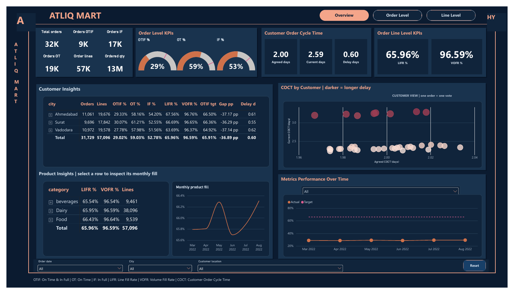
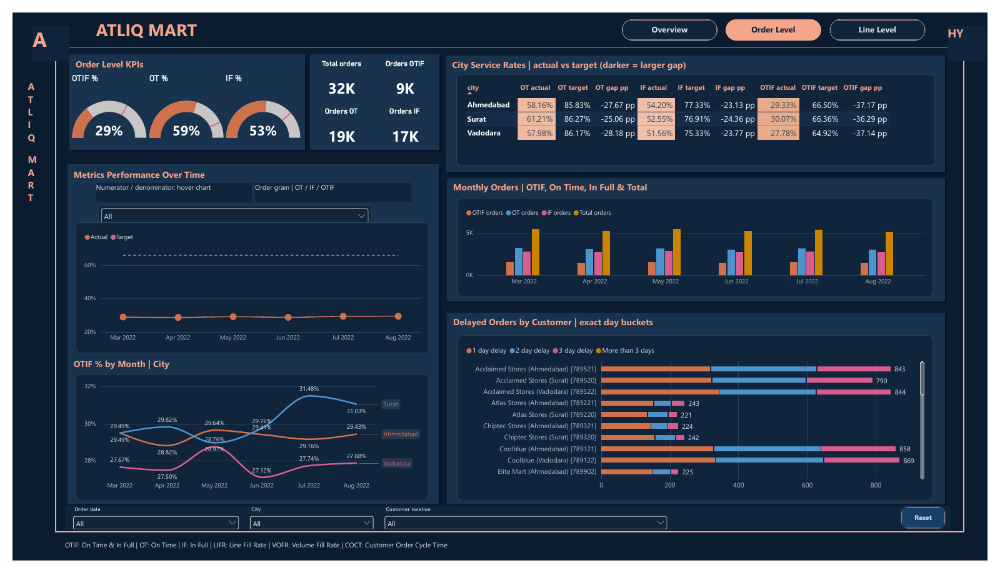
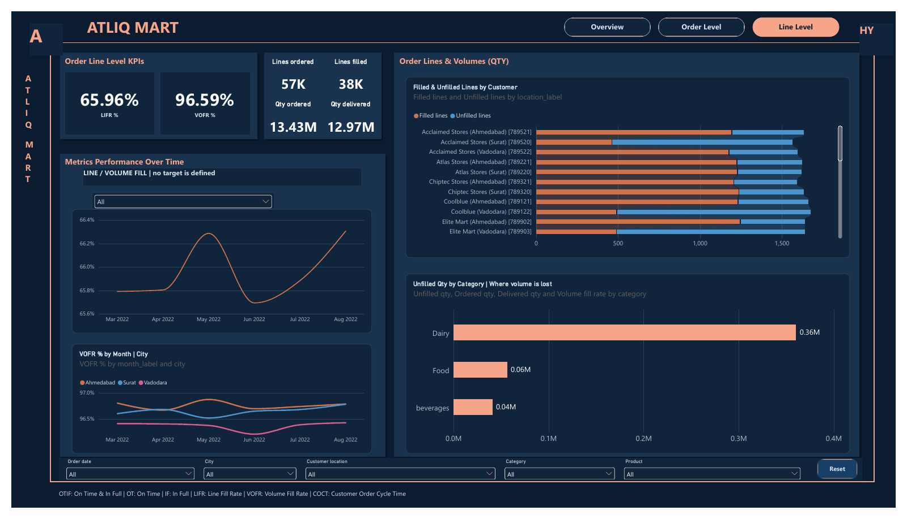
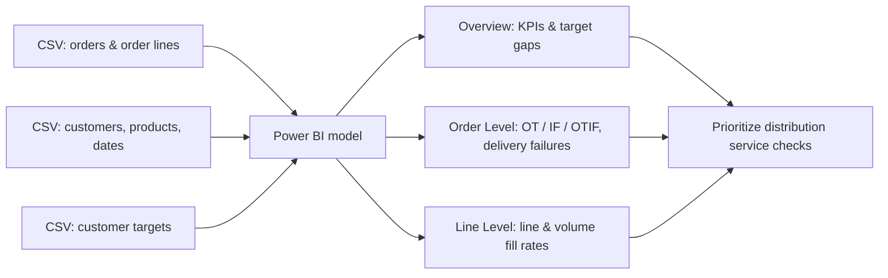

<div align="center">
  
  <h1>AtliQ Mart · Distribution Service Dashboard</h1>
  <p><strong>Track on-time and complete deliveries to find problems before expanding.</strong></p>
  <p><a href="README.md">Tiếng Việt</a> · <a href="README.en.md"><strong>English</strong></a></p>
  <p>
    
    
    
    
  </p>
  <p><a href="README.html">View interactive version</a> · <a href="#getting-started">Explore Docs</a> · <a href="https://github.com/lengominhhuy510-maker/Supply-chain-FMCG-distribution-dashboard/issues/new">Report Bug</a> · <a href="https://github.com/lengominhhuy510-maker/Supply-chain-FMCG-distribution-dashboard/issues/new">Request Feature</a></p>
</div>

## Problem → signs → what to do

**Problem:** AtliQ Mart makes everyday goods in Gujarat and delivers to Surat, Ahmedabad, and Vadodara. Some key customers did not renew their contracts because essential items arrived late or in smaller amounts than ordered. Before expanding to more cities, the company needs to improve **delivery service**.

**Sign, not a proven cause:** Out of 22,521 orders that missed OTIF, 9,522 (42.28%) arrived on time but short — the largest group. The data has no quantity records for allocation, picking, dispatch, or receipt. We cannot yet say where the shortage starts or blame the warehouse or the carrier.

**What to do:** Use the Power BI dashboard to track on-time (OT), in-full (IF), and both together (OTIF). Compare these results with customer targets, then check each order and order line. The proposal suggests a 10-working-day A/B test on orders with delivery logs, checking quantities at each step. Also watch OT: fewer short orders are not an improvement if more arrive late. **The test has not been run.** This repo has no delivery logs or daily data refresh.

### See the dashboard

<div align="center">
  <a href="SupplyChain_Design_Dashboard.pdf"></a>
  <br />
  <sub>Overview · Click the image to open the full three-page PDF.</sub>
</div>

<details>
  <summary>More views: Order Level and Line Level</summary>
  <br />
  
  <br />
  
</details>

The images come from the [Power BI PDF](SupplyChain_Design_Dashboard.pdf). To use the filters, open the [PBIX file](SupplyChain_Design_Dashboard.pbix) in Power BI Desktop.

### How the data flows



### A snapshot from the data

| Metric | Result | Interpretation |
| --- | ---: | --- |
| Orders on time and in full (OTIF) | **9,208 / 31,729 = 29.02%** | Arrived on time with the full order. |
| Average OTIF target | **65.91%** | Simple average of 35 customer targets; each customer counts the same. |
| On time but short | **9,522** | Largest group among 22,521 orders that missed OTIF. |
| Lines filled in full | **65.96%** | Based on the number of order lines. |
| Volume delivered | **96.59%** | Delivered quantity / ordered quantity. This is not the line fill rate. |

These numbers come from the CSV files in this repo. They show past delivery results, **not the cause** of shortages.

## What the report shows

### Track deliveries

- **See OT, IF, and OTIF:** Of 31,729 orders, how many were late, short, or both?
- **Compare with targets:** Find the biggest gaps between actual results and OT, IF, and OTIF targets for 35 customers.
- **Filter the data:** Choose a date, city, or customer to focus on a smaller group.

### Find groups to check

- **Split problem orders:** 7,539 were only late, 9,522 were only short, and 5,460 were both. Each order appears in one group.
- **Look at order lines:** Compare the line fill rate (LIFR) with the volume fill rate (VOFR), then filter by product or category.
- **Check delays:** See the time from order to delivery and how many days orders were late.

## Tools

| Tool | What it does |
| --- | --- |
| Power BI Desktop (`.pbix`) | Opens the three interactive pages: Overview, Order Level, and Line Level. |
| CSV (`Dataset/`) | Stores four reference tables plus order and order-line data. |
| PowerPoint (`.pptx`) | Presents the problem, the data, and a proposed test. |
| Mermaid | Draws the data flow in the GitHub README. |

## Getting started

**Prerequisite:** Install a Power BI Desktop version that opens the PBIX. No version is pinned in this repo. Use any app that opens PPTX files for the proposal.

1. **Clone the repository:**

   ```bash
   git clone https://github.com/lengominhhuy510-maker/Supply-chain-FMCG-distribution-dashboard.git
   cd Supply-chain-FMCG-distribution-dashboard
   ```

2. **Open the report:** Open `SupplyChain_Design_Dashboard.pbix` in Power BI Desktop. Check the Overview, Order Level, and Line Level pages.
3. **Filter the data:** Choose a city, customer, or date. On Line Level, you can also filter by product or category. The original CSV files are in `Dataset/`. If Power BI asks for file paths when you refresh, select the matching CSV files there.
4. **Read the proposal:** Open `atliq-service-recovery-board-proposal.pptx` to see the suggested test for short deliveries.

> No build command or server is needed.

## Project structure

```text
.
├── README.md                              # Vietnamese documentation
├── README.en.md                           # English documentation
├── README.html                            # Interactive bilingual page with truck animation
├── dashboard-mark.svg                     # Navy / peach truck mark
├── Dataset/
│   ├── dim_customers.csv                  # Customers and cities
│   ├── dim_date.csv                       # Day / week / month calendar
│   ├── dim_products.csv                   # Products and categories
│   ├── dim_targets_orders.csv             # Customer OT / IF / OTIF targets
│   ├── fact_orders_aggregate.csv          # Order-level delivery outcomes
│   └── fact_order_lines.csv               # Ordered / delivered line quantities
├── docs/screenshots/                      # Three dashboard screenshots exported from PDF
│   ├── overview.png                       # KPI summary and target gaps
│   ├── order-level.png                    # Service rates and late-order buckets
│   └── line-level.png                     # Line and volume fill rates
├── SupplyChain_Design_Dashboard.pbix      # Three-page Power BI report
├── SupplyChain_Design_Dashboard.pdf       # Three-page Power BI export
└── atliq-service-recovery-board-proposal.pptx # Executive decision brief
```

## Usage examples

**Calculate OTIF from the CSV** with Python 3 (standard library only; this is an example, not a pipeline in the repo):

```bash
python -c "import csv; r=list(csv.DictReader(open('Dataset/fact_orders_aggregate.csv', encoding='utf-8-sig', newline=''))); ok=sum(int(x['otif']) for x in r); print(f'{ok:,} / {len(r):,} = {ok/len(r):.2%} OTIF')"
```

Expected output for the current dataset:

```text
9,208 / 31,729 = 29.02% OTIF
```

**Explore the report:** Open `Order Level` → filter by city, customer, or date → compare OT, IF, and OTIF with targets → go to `Line Level` to see which lines and products are short. Start with Overview for the big picture.

## Next steps & contributions

- [x] Build three report pages: Overview, Order Level, and Line Level.
- [x] Add six CSV tables and the proposal to the repo.
- [ ] Set up regular data updates and checks for data quality.
- [ ] Record quantities at allocation → picking → dispatch → receipt to find where shortages begin.

**Contribute:** Open an issue with the problem, steps to see it, and what you expected. For model changes, send a pull request with the data source and any effect on the metrics. Do not share real customer data or sensitive details in issues.

**License:** This repo has no `LICENSE` file. Do not assume you can reuse its code or data.
