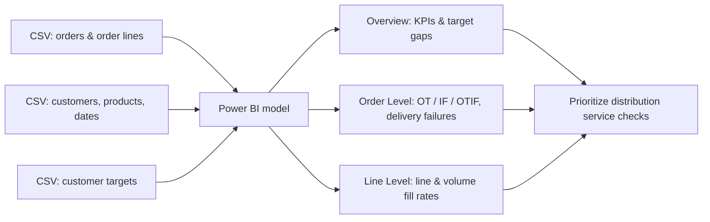

<div align="center">
  
  <h1>AtliQ Mart · Distribution Service Dashboard</h1>
  <p><strong>Track on-time, in-full delivery to pinpoint distribution bottlenecks before expansion.</strong></p>
  <p><a href="README.md">Tiếng Việt</a> · <a href="README.en.md"><strong>English</strong></a></p>
  <p>
    
    
    
    
  </p>
  <p><a href="README.html">View interactive version</a> · <a href="#getting-started">Explore Docs</a> · <a href="https://github.com/lengominhhuy510-maker/Supply-chain-FMCG-distribution-dashboard/issues/new">Report Bug</a> · <a href="https://github.com/lengominhhuy510-maker/Supply-chain-FMCG-distribution-dashboard/issues/new">Request Feature</a></p>
</div>

## Problem → signal → response

**Problem:** AtliQ Mart is a growing FMCG manufacturer based in Gujarat, operating in Surat, Ahmedabad, and Vadodara. Important customers have declined annual renewals amid late or incomplete deliveries of essential products; the company needs to improve service **at the distribution stage** before expanding to more major cities.

**Signal to investigate, not a proven cause:** Among 22,521 orders missing OTIF, the largest group consists of 9,522 orders (42.28%) delivered on time but short. Current data does not record quantities at allocation, picking, dispatch, and receipt, so it cannot locate the shortage or assign fault to the warehouse or carrier.

**Response:** The Power BI dashboard tracks on-time (OT), in-full (IF), and on-time-in-full (OTIF) performance by order, compares results against customer targets, and drills into order lines. The decision brief proposes a 10-working-day A/B pilot on logged orders to reconcile each handoff while keeping OT under observation, so fewer short orders do not become later orders. This repo **does not** provide a daily refresh pipeline or operational logs; the pilot is a proposal, not an implemented result.

### Dashboard preview

<div align="center">
  <a href="SupplyChain_Design_Dashboard.pdf"></a>
  <br />
  <sub>Overview · Select the image to open the complete three-page PDF report.</sub>
</div>

<details>
  <summary>More views: Order Level and Line Level</summary>
  <br />
  
  <br />
  
</details>

Screenshots come from the [Power BI export](SupplyChain_Design_Dashboard.pdf). Open the [PBIX file](SupplyChain_Design_Dashboard.pbix) in Power BI Desktop to use the interactive filters.

### Analysis flow



### A snapshot from the data

| Metric | Result | Interpretation |
| --- | ---: | --- |
| Orders meeting OTIF | **9,208 / 31,729 = 29.02%** | Delivered both on time and in full. |
| Average OTIF target | **65.91%** | Simple average of 35 customer targets; not weighted by order count. |
| On-time but short orders | **9,522** | Largest group among 22,521 orders missing OTIF. |
| Lines filled in full | **65.96%** | Based on order-line counts. |
| Volume delivered | **96.59%** | Total delivered quantity / total ordered quantity; not the same as line fill rate. |

These figures come from the included CSVs. They describe historical delivery outcomes, not the root cause of shortages.

## Key capabilities

### Monitor service levels

- **Measure OT, IF, and OTIF:** Aggregate outcomes across 31,729 orders to separate late, short, and combined delivery failures.
- **Compare customer targets:** Contrast actual OT, IF, and OTIF rates with targets for 35 customers to prioritize service gaps.
- **Filter dates, cities, and customers:** Narrow the report pages to the segments that need attention.

### Isolate failure patterns

- **Classify order-level failures:** Distinguish late-only (7,539), short-only (9,522), and late-and-short (5,460) orders; these are mutually exclusive groups among 22,521 orders missing OTIF.
- **Analyze order-line fill:** Compare line item fill rate (LIFR) with volume order fill rate (VOFR), then filter by product and category to expose shortages masked by aggregate volume.
- **Inspect delivery timing:** Review order-to-delivery timing and delay buckets to assess the extent of late deliveries.

## Tech stack

| Component | Why it is used |
| --- | --- |
| Power BI Desktop (`.pbix`) | Hosts the model and three interactive report pages: Overview, Order Level, Line Level. |
| CSV (`Dataset/`) | Supplies four dimensions, an order-level fact table, and an order-line fact table. |
| PowerPoint (`.pptx`) | Presents the service problem, evidence, and a proposed pilot to investigate shortages. |
| Mermaid | Renders the data flow directly in GitHub Markdown. |

## Getting started

**Prerequisite:** Install a Power BI Desktop version that can open the `.pbix` file. No `package.json`, `requirements.txt`, or pinned Power BI version exists in this repo. Use software that supports `.pptx` to view the decision brief.

1. **Clone the repository:**

   ```bash
   git clone https://github.com/lengominhhuy510-maker/Supply-chain-FMCG-distribution-dashboard.git
   cd Supply-chain-FMCG-distribution-dashboard
   ```

2. **Open the report:** Open `SupplyChain_Design_Dashboard.pbix` in Power BI Desktop. The file contains Overview, Order Level, and Line Level pages.
3. **Explore the data:** Filter by city, customer, and date; the Line Level page also exposes product and category filters. Inspect `Dataset/` to trace the CSV inputs. If a refresh prompts for a source location, point it to the corresponding files in this directory.
4. **Read the decision brief:** Open `atliq-service-recovery-board-proposal.pptx` for the shortage analysis and proposed quantity-reconciliation pilot.

> You can open the saved PBIX report directly; **refreshing** it may require updating local CSV source paths. This repo has no build command or server to run.

## Project structure

```text
.
├── README.md                              # Vietnamese documentation
├── README.en.md                           # English documentation
├── README.html                            # Interactive bilingual page with truck animation
├── dashboard-mark.svg                     # Navy / peach truck mark
├── Dataset/
│   ├── dim_customers.csv                  # Customers and cities
│   ├── dim_date.csv                       # Day / week / month calendar
│   ├── dim_products.csv                   # Products and categories
│   ├── dim_targets_orders.csv             # Customer OT / IF / OTIF targets
│   ├── fact_orders_aggregate.csv          # Order-level delivery outcomes
│   └── fact_order_lines.csv               # Ordered / delivered line quantities
├── docs/screenshots/                      # Three dashboard screenshots exported from PDF
│   ├── overview.png                       # KPI summary and target gaps
│   ├── order-level.png                    # Service rates and late-order buckets
│   └── line-level.png                     # Line and volume fill rates
├── SupplyChain_Design_Dashboard.pbix      # Three-page Power BI report
├── SupplyChain_Design_Dashboard.pdf       # Three-page Power BI export
└── atliq-service-recovery-board-proposal.pptx # Executive decision brief
```

## Usage examples

**Calculate OTIF from the order data** with Python 3 (standard library; this example is not a pipeline included in the repo):

```bash
python -c "import csv; r=list(csv.DictReader(open('Dataset/fact_orders_aggregate.csv', encoding='utf-8-sig', newline=''))); ok=sum(int(x['otif']) for x in r); print(f'{ok:,} / {len(r):,} = {ok/len(r):.2%} OTIF')"
```

Expected output for the current dataset:

```text
9,208 / 31,729 = 29.02% OTIF
```

**Investigate in the report:** Open `Order Level` → filter by city / customer / date → compare OT, IF, and OTIF against targets → open `Line Level` to inspect LIFR, VOFR, and affected products. Use Overview for the initial service-level picture.

## Roadmap & contributing

- [x] Build three report views: overview, order level, and line level.
- [x] Include six source CSVs and the executive decision brief.
- [ ] Establish scheduled data updates and source-quality checks.
- [ ] Log quantities at allocation → picking → dispatch → receipt to test where shortages arise.

**Contribute:** Open an issue with reproduction steps and expected behavior. For model changes, submit a pull request describing the data source and metric impact. Do not post real customer data or sensitive information in issues.

**License:** No `LICENSE` file is present; do not assume the code or data is licensed for reuse.
