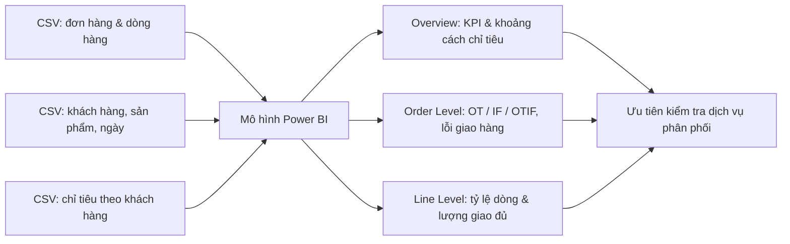

<div align="center">
  
  <h1>AtliQ Mart · Distribution Service Dashboard</h1>
  <p><strong>Theo dõi mức độ giao hàng đúng hạn và đầy đủ để xác định điểm nghẽn phân phối trước khi mở rộng.</strong></p>
  <p><a href="README.md"><strong>Tiếng Việt</strong></a> · <a href="README.en.md">English</a></p>
  <p>
    
    
    
    
  </p>
  <p><a href="README.html">Xem bản tương tác</a> · <a href="#bat-dau">Khám phá tài liệu</a> · <a href="https://github.com/lengominhhuy510-maker/Supply-chain-FMCG-distribution-dashboard/issues/new">Báo lỗi</a> · <a href="https://github.com/lengominhhuy510-maker/Supply-chain-FMCG-distribution-dashboard/issues/new">Đề xuất tính năng</a></p>
</div>

## Vấn đề → dấu hiệu → hướng xử lý

**Vấn đề:** AtliQ Mart là nhà sản xuất FMCG tại Gujarat, hoạt động ở Surat, Ahmedabad và Vadodara. Một số khách hàng quan trọng không gia hạn hợp đồng vì hàng thiết yếu giao trễ hoặc thiếu; công ty cần xử lý chất lượng dịch vụ **ở giai đoạn phân phối** trước khi mở rộng sang các thành phố lớn khác.

**Dấu hiệu cần điều tra, chưa phải nguyên nhân đã chứng minh:** Trong 22.521 đơn không đạt OTIF, nhóm lớn nhất gồm 9.522 đơn (42,28%) giao đúng hạn nhưng thiếu hàng. Dữ liệu hiện tại chưa ghi nhận số lượng tại các mốc phân bổ, soạn hàng, xuất kho và nhận hàng; chưa thể xác định nơi phát sinh thiếu hụt hay quy lỗi cho kho hoặc vận chuyển.

**Hướng xử lý:** Dashboard Power BI theo dõi OT (đúng hạn), IF (đầy đủ) và OTIF (đúng hạn **và** đầy đủ) ở cấp đơn, đối chiếu chỉ tiêu khách hàng và phân tích sâu đến dòng hàng. Bản trình bày đề xuất pilot A/B 10 ngày làm việc trên nhóm đơn có log để đối soát từng mốc, đồng thời theo dõi OT nhằm tránh giảm giao thiếu bằng cách giao trễ hơn. Repo **không** chứa pipeline cập nhật hằng ngày hay log vận hành; pilot là đề xuất, chưa phải kết quả triển khai.

### Xem dashboard

<div align="center">
  <a href="SupplyChain_Design_Dashboard.pdf"></a>
  <br />
  <sub>Overview · Nhấp vào ảnh để xem toàn bộ báo cáo PDF (3 trang).</sub>
</div>

<details>
  <summary>Xem thêm: Order Level và Line Level</summary>
  <br />
  
  <br />
  
</details>

Ảnh chụp từ [bản PDF xuất từ Power BI](SupplyChain_Design_Dashboard.pdf); để lọc tương tác, mở [tệp PBIX](SupplyChain_Design_Dashboard.pbix) trong Power BI Desktop.

### Luồng phân tích



### Một lát cắt từ dữ liệu

| Chỉ số | Kết quả | Cách hiểu |
| --- | ---: | --- |
| Đơn hàng đạt OTIF | **9.208 / 31.729 = 29,02%** | Giao vừa đúng hạn vừa đầy đủ. |
| Chỉ tiêu OTIF trung bình | **65,91%** | Trung bình đơn giản từ chỉ tiêu của 35 khách hàng; không gia quyền theo số đơn. |
| Đơn đúng hạn nhưng thiếu hàng | **9.522** | Nhóm lớn nhất trong 22.521 đơn không đạt OTIF. |
| Dòng hàng giao đủ | **65,96%** | Tính theo số dòng hàng. |
| Lượng hàng được giao | **96,59%** | Tổng lượng giao / tổng lượng đặt; khác với tỷ lệ dòng giao đủ. |

Các con số trên tính từ CSV đi kèm; chúng mô tả dữ liệu lịch sử, không chứng minh nguyên nhân gây thiếu hàng.

## Năng lực chính

### Theo dõi dịch vụ

- **Đo OT, IF và OTIF:** Tổng hợp trạng thái 31.729 đơn hàng để nhìn rõ giao trễ, giao thiếu và lỗi kết hợp.
- **Đối chiếu chỉ tiêu khách hàng:** So sánh tỷ lệ thực tế với mục tiêu OT, IF, OTIF của 35 khách hàng, giúp ưu tiên khoảng cách dịch vụ.
- **Lọc theo ngày, thành phố và khách hàng:** Thu hẹp phạm vi trên các trang báo cáo để nhận diện nơi cần kiểm tra.

### Khoanh vùng vấn đề

- **Phân tách lỗi cấp đơn:** Phân biệt đơn chỉ trễ (7.539), chỉ thiếu (9.522) và vừa trễ vừa thiếu (5.460); đây là ba nhóm loại trừ nhau trong 22.521 đơn không đạt OTIF.
- **Phân tích cấp dòng hàng:** So sánh dòng giao đủ (LIFR) với lượng giao đủ (VOFR), rồi lọc theo sản phẩm và danh mục để tìm thiếu hụt bị che khuất bởi tỷ lệ tổng.
- **Theo dõi thời gian giao:** Quan sát thời gian từ đặt đến giao và các nhóm ngày trễ để đánh giá mức độ ảnh hưởng.

## Công nghệ

| Thành phần | Vai trò |
| --- | --- |
| Power BI Desktop (`.pbix`) | Mở mô hình và ba trang báo cáo tương tác: Overview, Order Level, Line Level. |
| CSV (`Dataset/`) | Cung cấp bốn bảng chiều, một bảng đơn hàng tổng hợp và một bảng dòng hàng. |
| PowerPoint (`.pptx`) | Trình bày vấn đề, bằng chứng và đề xuất pilot kiểm chứng nguyên nhân. |
| Mermaid | Minh họa luồng dữ liệu ngay trong README trên GitHub. |

<a id="bat-dau"></a>

## Bắt đầu

**Yêu cầu:** Cài Power BI Desktop có thể mở tệp `.pbix`. Repo không có `package.json`, `requirements.txt` hoặc phiên bản Power BI được khóa; hãy dùng bản Power BI Desktop tương thích với tệp báo cáo. Để xem bản trình bày, dùng phần mềm hỗ trợ `.pptx`.

1. **Sao chép repo:**

   ```bash
   git clone https://github.com/lengominhhuy510-maker/Supply-chain-FMCG-distribution-dashboard.git
   cd Supply-chain-FMCG-distribution-dashboard
   ```

2. **Mở báo cáo:** Mở `SupplyChain_Design_Dashboard.pbix` trong Power BI Desktop. Ba trang Overview, Order Level và Line Level đã nằm trong tệp báo cáo.
3. **Khám phá dữ liệu:** Lọc thành phố, khách hàng và ngày; trên Line Level có thêm bộ lọc sản phẩm và danh mục. Đọc `Dataset/` để đối chiếu nguồn CSV; nếu Power BI yêu cầu sửa đường dẫn dữ liệu khi làm mới, trỏ tới các tệp tương ứng trong thư mục này.
4. **Đọc đề xuất:** Mở `atliq-service-recovery-board-proposal.pptx` để xem lập luận về nhóm đơn thiếu hàng và pilot đối soát số lượng.

> Tệp PBIX có thể mở như báo cáo đã lưu; thao tác **Refresh** có thể cần cập nhật đường dẫn nguồn CSV theo máy của bạn. Repo không cung cấp lệnh build hoặc server để chạy.

## Cấu trúc dự án

```text
.
├── README.md                              # Tài liệu tiếng Việt
├── README.en.md                           # English documentation
├── README.html                            # Trang tương tác song ngữ, hiệu ứng xe tải
├── dashboard-mark.svg                     # Biểu tượng xe tải navy / cam hồng đào
├── Dataset/
│   ├── dim_customers.csv                  # Khách hàng và thành phố
│   ├── dim_date.csv                       # Lịch ngày / tuần / tháng
│   ├── dim_products.csv                   # Sản phẩm và danh mục
│   ├── dim_targets_orders.csv             # Chỉ tiêu OT / IF / OTIF theo khách hàng
│   ├── fact_orders_aggregate.csv          # Kết quả giao hàng cấp đơn
│   └── fact_order_lines.csv               # Số lượng đặt / giao cấp dòng hàng
├── docs/screenshots/                      # Ảnh chụp ba trang dashboard từ PDF
│   ├── overview.png                       # Tổng quan KPI và khoảng cách chỉ tiêu
│   ├── order-level.png                    # Tỷ lệ dịch vụ và nhóm đơn trễ
│   └── line-level.png                     # Tỷ lệ giao đủ dòng / số lượng
├── SupplyChain_Design_Dashboard.pbix      # Dashboard Power BI, ba trang
├── SupplyChain_Design_Dashboard.pdf       # Bản PDF xuất từ Power BI, ba trang
└── atliq-service-recovery-board-proposal.pptx # Đề xuất cho ban điều hành
```

## Ví dụ sử dụng

**Tính OTIF từ dữ liệu đơn hàng** bằng Python 3 (thư viện chuẩn; ví dụ này không phải pipeline của repo):

```bash
python -c "import csv; r=list(csv.DictReader(open('Dataset/fact_orders_aggregate.csv', encoding='utf-8-sig', newline=''))); ok=sum(int(x['otif']) for x in r); print(f'{ok:,} / {len(r):,} = {ok/len(r):.2%} OTIF')"
```

Kết quả mong đợi trên dữ liệu hiện có:

```text
9,208 / 31,729 = 29.02% OTIF
```

**Khoanh vùng trong báo cáo:** Chọn `Order Level` → lọc thành phố / khách hàng / ngày → so sánh OT, IF, OTIF với chỉ tiêu → chuyển sang `Line Level` để xem LIFR, VOFR và sản phẩm liên quan. Trang Overview tóm tắt toàn cảnh trước khi đi sâu.

## Lộ trình & đóng góp

- [x] Xây dựng báo cáo ba cấp nhìn: tổng quan, đơn hàng, dòng hàng.
- [x] Đưa sáu bảng CSV và bản trình bày đề xuất vào repo.
- [ ] Thiết lập quy trình cập nhật dữ liệu định kỳ và kiểm tra chất lượng nguồn.
- [ ] Ghi nhận số lượng tại từng bước phân bổ → soạn hàng → xuất kho → nhận hàng để kiểm chứng nguyên nhân thiếu hàng.

**Đóng góp:** Mở issue để mô tả lỗi, cách tái hiện và kết quả mong đợi; gửi pull request kèm nguồn dữ liệu / ảnh hưởng đến chỉ số nếu thay đổi mô hình. Không đăng dữ liệu khách hàng thực hoặc thông tin nhạy cảm vào issue.

**Giấy phép:** Repo hiện chưa có tệp `LICENSE`; không mặc định coi mã nguồn hay dữ liệu được cấp phép sử dụng lại.
