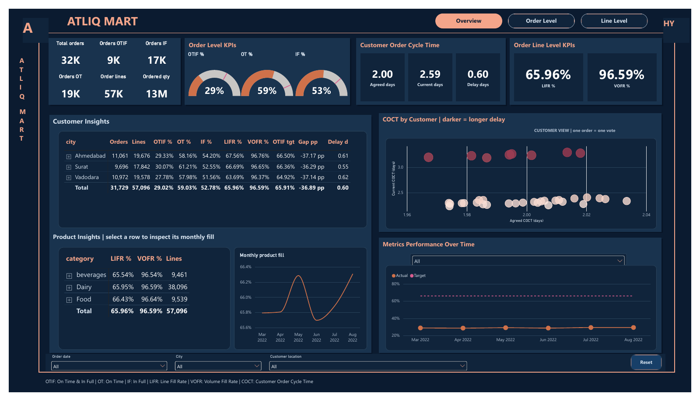
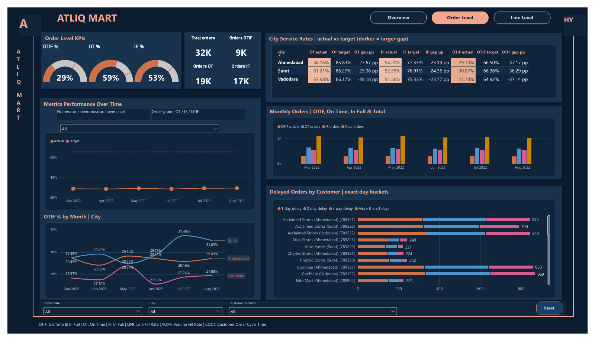
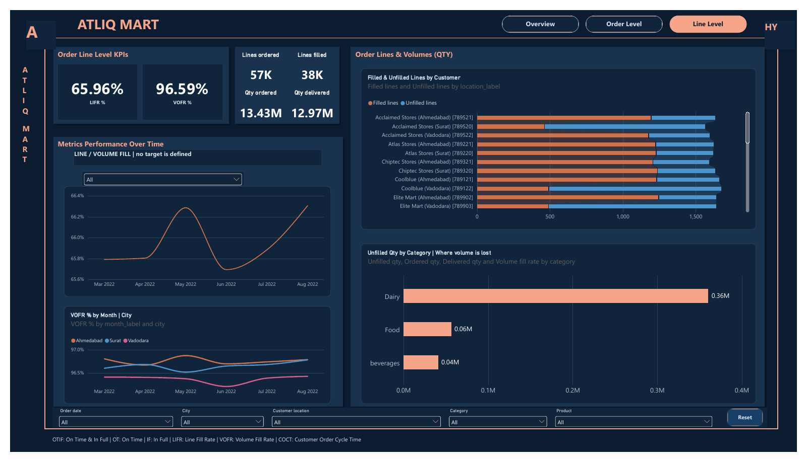
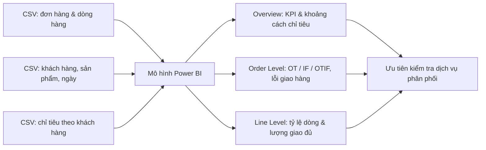

<div align="center">
  
  <h1>AtliQ Mart · Distribution Service Dashboard</h1>
  <p><strong>Theo dõi giao hàng đúng hạn và đủ số lượng để tìm điểm nghẽn trước khi mở rộng.</strong></p>
  <p><a href="README.md"><strong>Tiếng Việt</strong></a> · <a href="README.en.md">English</a></p>
  <p>
    
    
    
    
  </p>
  <p><a href="README.html">Xem bản tương tác</a> · <a href="#bat-dau">Khám phá tài liệu</a> · <a href="https://github.com/lengominhhuy510-maker/Supply-chain-FMCG-distribution-dashboard/issues/new">Báo lỗi</a> · <a href="https://github.com/lengominhhuy510-maker/Supply-chain-FMCG-distribution-dashboard/issues/new">Đề xuất tính năng</a></p>
</div>

## Vấn đề → dấu hiệu → việc cần làm

**Vấn đề:** AtliQ Mart sản xuất hàng tiêu dùng nhanh tại Gujarat và phân phối ở Surat, Ahmedabad và Vadodara. Một số khách hàng lớn không gia hạn hợp đồng vì hàng thiết yếu đến trễ hoặc thiếu. Trước khi mở rộng, công ty cần cải thiện **khâu phân phối**.

**Dấu hiệu, chưa phải nguyên nhân:** Có 22.521 đơn không đạt OTIF, tức là không giao được cả đúng hạn lẫn đủ hàng. Trong đó, 9.522 đơn (42,28%) đến đúng hạn nhưng thiếu hàng — nhóm lớn nhất. Dữ liệu chưa cho biết hàng thiếu ở bước phân bổ, soạn hàng, xuất kho hay nhận hàng, nên chưa thể quy lỗi cho bên nào.

**Việc cần làm:** Dùng dashboard Power BI để xem tỷ lệ giao đúng hạn (OT), giao đủ (IF) và cả hai (OTIF). So sánh với chỉ tiêu của khách hàng, rồi xem chi tiết từng đơn và dòng hàng. Bản đề xuất gợi ý thử nghiệm A/B trong 10 ngày làm việc trên các đơn có nhật ký giao nhận để đối soát số lượng ở từng bước. Cần theo dõi cả OT: giảm giao thiếu mà tăng giao trễ không phải là cải thiện. **Thử nghiệm này chưa được triển khai**; repo cũng chưa có nhật ký vận hành hay hệ thống cập nhật dữ liệu hằng ngày.

### Ảnh dashboard

<div align="center">
  <a href="SupplyChain_Design_Dashboard.pdf"></a>
  <br />
  <sub>Overview · Bấm ảnh để mở bản PDF đầy đủ (3 trang).</sub>
</div>

<details>
  <summary>Xem thêm: Order Level và Line Level</summary>
  <br />
  
  <br />
  
</details>

Ảnh được xuất từ [bản PDF Power BI](SupplyChain_Design_Dashboard.pdf). Để dùng bộ lọc tương tác, mở [tệp PBIX](SupplyChain_Design_Dashboard.pbix) trong Power BI Desktop.

### Luồng phân tích



### Một lát cắt từ dữ liệu

| Chỉ số | Kết quả | Cách hiểu |
| --- | ---: | --- |
| Đơn giao đúng hạn và đủ hàng (OTIF) | **9.208 / 31.729 = 29,02%** | Cả đúng hạn lẫn đủ hàng. |
| Chỉ tiêu OTIF trung bình | **65,91%** | Trung bình chỉ tiêu của 35 khách hàng; mỗi khách hàng được tính như nhau. |
| Đơn đúng hạn nhưng thiếu hàng | **9.522** | Nhóm lớn nhất trong 22.521 đơn không đạt OTIF. |
| Dòng hàng giao đủ | **65,96%** | Tính theo số dòng hàng. |
| Lượng hàng được giao | **96,59%** | Tổng số lượng giao / tổng số lượng đặt; không phải tỷ lệ dòng giao đủ. |

Các số liệu lấy từ CSV trong repo. Chúng cho thấy tình hình giao hàng trước đây, **không chỉ ra nguyên nhân** giao thiếu.

## Báo cáo giúp gì?

### Theo dõi giao hàng

- **Xem OT, IF và OTIF:** Trong 31.729 đơn hàng, bao nhiêu đơn đến trễ, thiếu hàng hoặc gặp cả hai vấn đề?
- **So với chỉ tiêu:** Tìm khách hàng có khoảng cách lớn nhất giữa kết quả thực tế và mục tiêu OT, IF, OTIF.
- **Lọc dữ liệu:** Chọn ngày, thành phố hoặc khách hàng để xem nhóm cần chú ý.

### Tìm nhóm cần kiểm tra

- **Tách nhóm đơn lỗi:** 7.539 đơn chỉ trễ, 9.522 đơn chỉ thiếu và 5.460 đơn vừa trễ vừa thiếu. Mỗi đơn chỉ nằm trong một nhóm.
- **Xem từng dòng hàng:** So tỷ lệ dòng giao đủ (LIFR) với tỷ lệ số lượng giao đủ (VOFR), rồi lọc theo sản phẩm và danh mục.
- **Xem độ trễ:** Theo dõi thời gian từ khi đặt đến khi giao và số ngày giao trễ.

## Công nghệ

| Thành phần | Dùng để làm gì |
| --- | --- |
| Power BI Desktop (`.pbix`) | Mở ba trang báo cáo tương tác: Overview, Order Level, Line Level. |
| CSV (`Dataset/`) | Lưu bốn bảng thông tin và hai bảng dữ liệu đơn hàng, dòng hàng. |
| PowerPoint (`.pptx`) | Trình bày vấn đề, số liệu và thử nghiệm được đề xuất. |
| Mermaid | Vẽ sơ đồ luồng dữ liệu ngay trên GitHub. |

<a id="bat-dau"></a>

## Bắt đầu

**Yêu cầu:** Cài Power BI Desktop mở được tệp `.pbix`. Repo không quy định phiên bản cụ thể. Để xem bản đề xuất, cần phần mềm đọc tệp `.pptx`.

1. **Sao chép repo:**

   ```bash
   git clone https://github.com/lengominhhuy510-maker/Supply-chain-FMCG-distribution-dashboard.git
   cd Supply-chain-FMCG-distribution-dashboard
   ```

2. **Mở báo cáo:** Mở `SupplyChain_Design_Dashboard.pbix` bằng Power BI Desktop và xem ba trang Overview, Order Level, Line Level.
3. **Lọc dữ liệu:** Chọn thành phố, khách hàng và ngày. Trang Line Level còn lọc được sản phẩm và danh mục. Muốn xem dữ liệu gốc, mở các tệp trong `Dataset/`. Nếu Power BI hỏi đường dẫn khi làm mới, chọn lại CSV tương ứng trong thư mục này.
4. **Xem đề xuất:** Mở `atliq-service-recovery-board-proposal.pptx` để đọc về nhóm đơn thiếu hàng và thử nghiệm được đề xuất.

> Repo không cần lệnh build hay server.

## Cấu trúc dự án

```text
.
├── README.md                              # Tài liệu tiếng Việt
├── README.en.md                           # English documentation
├── README.html                            # Trang tương tác song ngữ, hiệu ứng xe tải
├── dashboard-mark.svg                     # Biểu tượng xe tải navy / cam hồng đào
├── Dataset/
│   ├── dim_customers.csv                  # Khách hàng và thành phố
│   ├── dim_date.csv                       # Lịch ngày / tuần / tháng
│   ├── dim_products.csv                   # Sản phẩm và danh mục
│   ├── dim_targets_orders.csv             # Chỉ tiêu OT / IF / OTIF theo khách hàng
│   ├── fact_orders_aggregate.csv          # Kết quả giao hàng cấp đơn
│   └── fact_order_lines.csv               # Số lượng đặt / giao cấp dòng hàng
├── docs/screenshots/                      # Ảnh chụp ba trang dashboard từ PDF
│   ├── overview.png                       # Tổng quan KPI và khoảng cách chỉ tiêu
│   ├── order-level.png                    # Tỷ lệ dịch vụ và nhóm đơn trễ
│   └── line-level.png                     # Tỷ lệ giao đủ dòng / số lượng
├── SupplyChain_Design_Dashboard.pbix      # Dashboard Power BI, ba trang
├── SupplyChain_Design_Dashboard.pdf       # Bản PDF xuất từ Power BI, ba trang
└── atliq-service-recovery-board-proposal.pptx # Đề xuất cho ban điều hành
```

## Ví dụ sử dụng

**Tính OTIF từ dữ liệu đơn hàng** bằng Python 3 (chỉ dùng thư viện có sẵn; đây là ví dụ, không phải pipeline của repo):

```bash
python -c "import csv; r=list(csv.DictReader(open('Dataset/fact_orders_aggregate.csv', encoding='utf-8-sig', newline=''))); ok=sum(int(x['otif']) for x in r); print(f'{ok:,} / {len(r):,} = {ok/len(r):.2%} OTIF')"
```

Kết quả mong đợi trên dữ liệu hiện có:

```text
9,208 / 31,729 = 29.02% OTIF
```

**Xem chi tiết trong báo cáo:** Mở `Order Level` → lọc theo thành phố, khách hàng hoặc ngày → so OT, IF, OTIF với chỉ tiêu → sang `Line Level` để xem dòng hàng và sản phẩm nào bị thiếu. Trang Overview cho cái nhìn tổng quan.

## Tiếp theo & đóng góp

- [x] Hoàn thành ba trang báo cáo: tổng quan, đơn hàng, dòng hàng.
- [x] Đưa sáu bảng CSV và bản đề xuất vào repo.
- [ ] Cập nhật dữ liệu định kỳ và kiểm tra chất lượng dữ liệu nguồn.
- [ ] Ghi lại số lượng ở từng bước phân bổ → soạn hàng → xuất kho → nhận hàng để tìm ra nơi phát sinh thiếu hụt.

**Đóng góp:** Mở issue và nêu rõ lỗi, cách gặp lỗi, kết quả mong muốn. Nếu sửa mô hình, gửi pull request kèm nguồn dữ liệu và tác động lên các chỉ số. Không đưa dữ liệu khách hàng thật hoặc thông tin nhạy cảm lên issue.

**Giấy phép:** Repo chưa có tệp `LICENSE`. Đừng mặc định mã nguồn hoặc dữ liệu được phép dùng lại.
